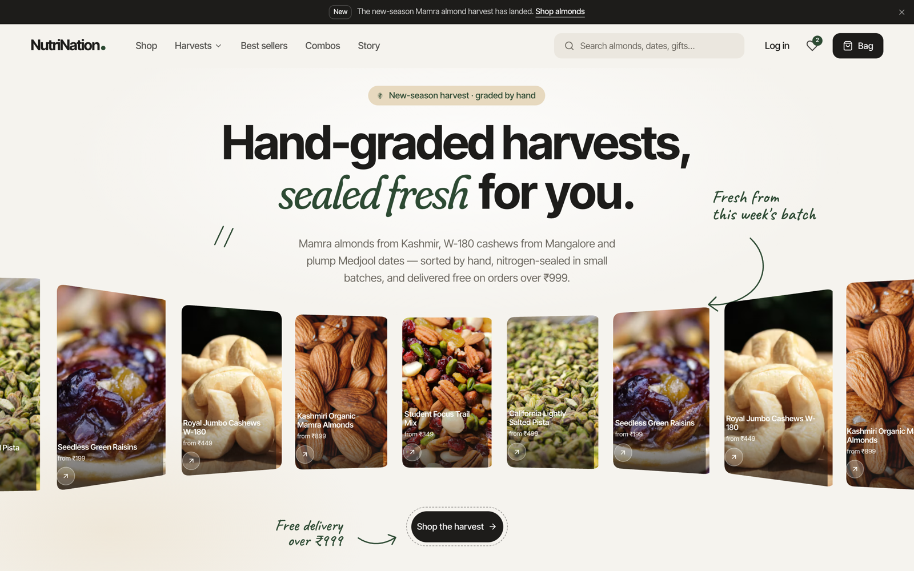
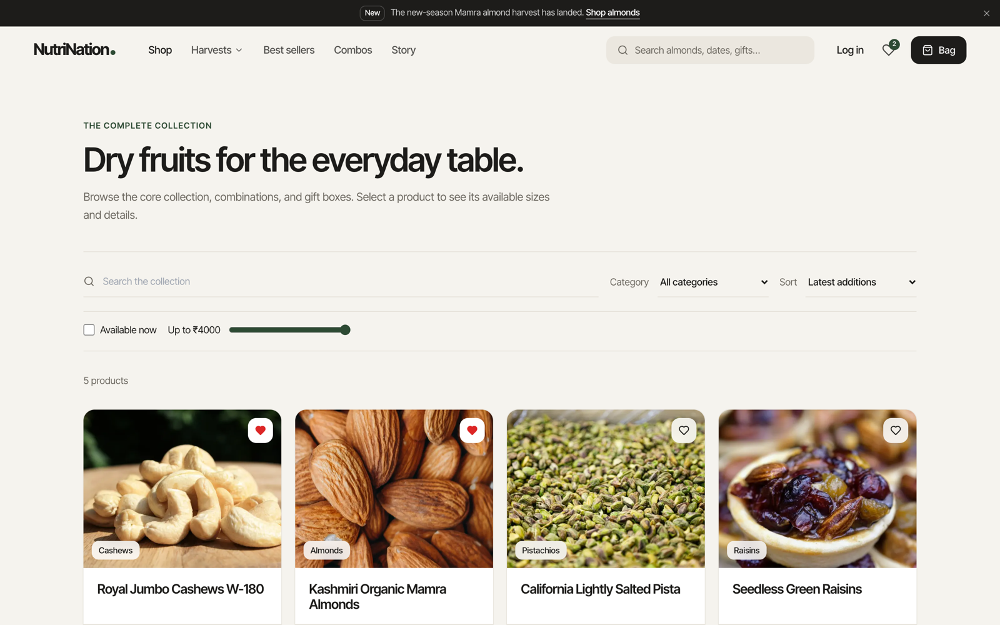
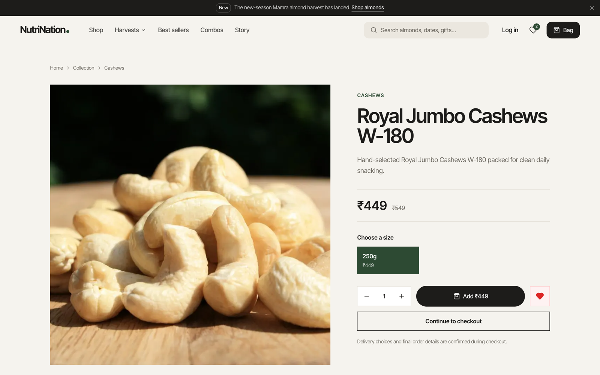
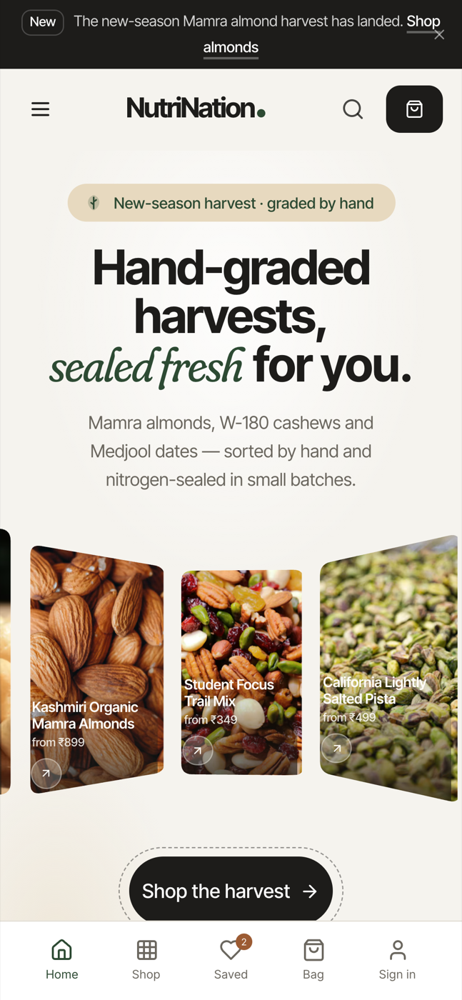
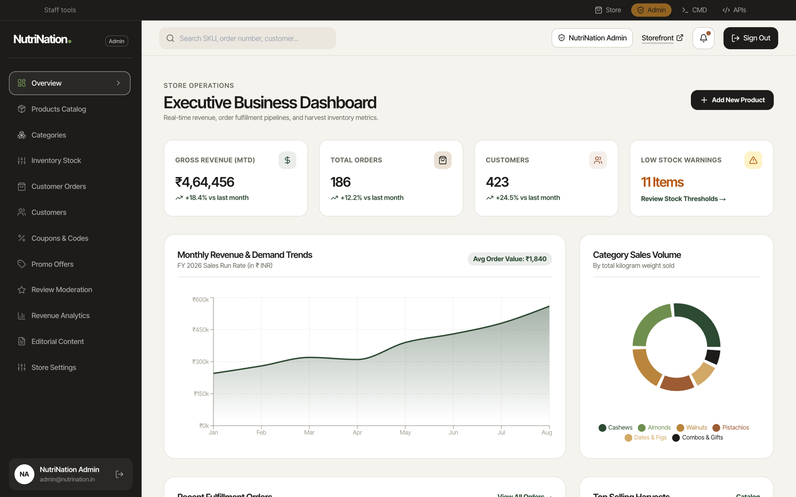
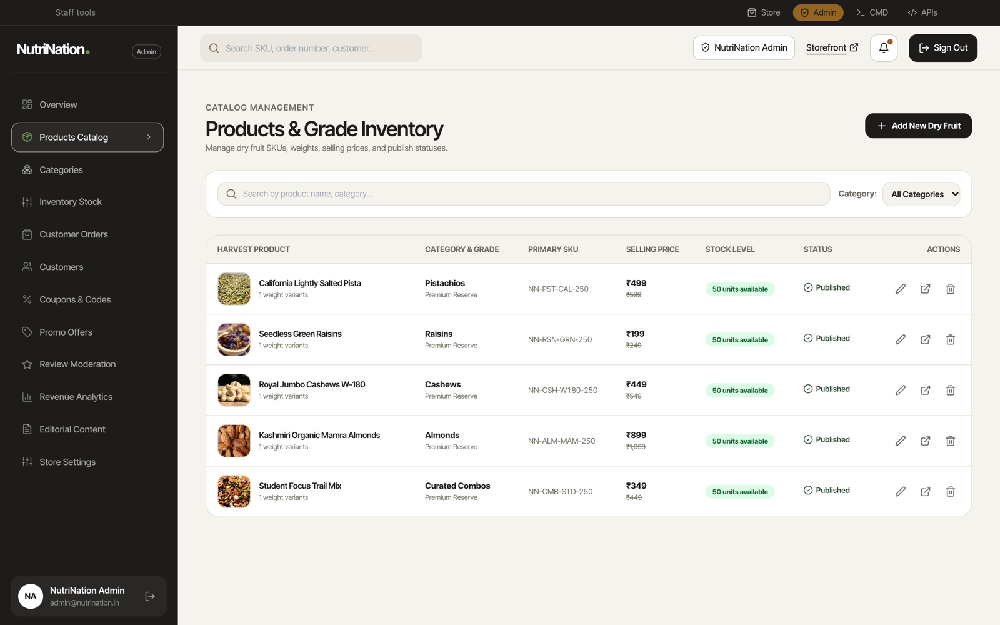
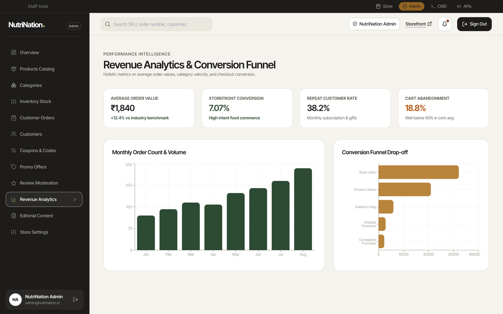
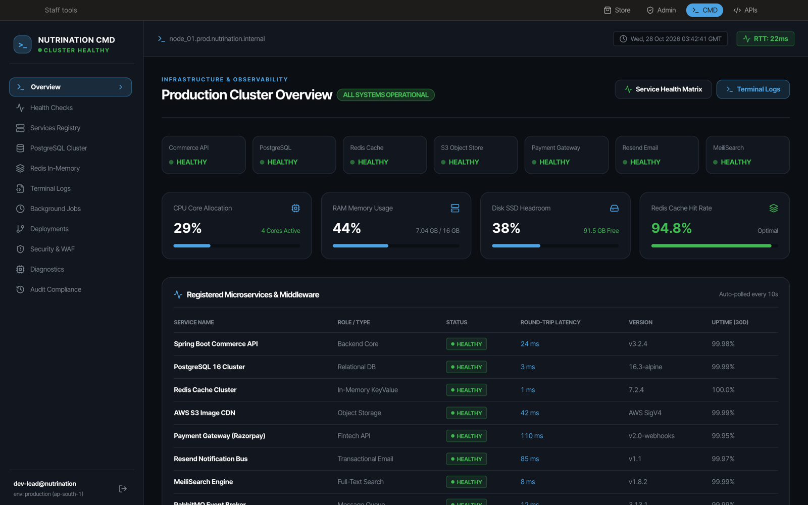
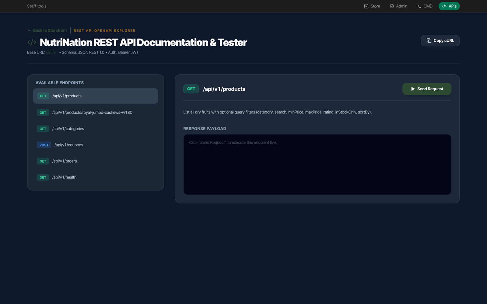

<div align="center">

# NutriNation

**A premium dry-fruits commerce platform: an editorial storefront, a full admin console, and a Spring Boot microservice backend.**


<br/>



</div>

---

## Overview

NutriNation is an end-to-end e-commerce platform for hand-graded dry fruits: Mamra almonds, W-180 cashews, Medjool dates, pistachios, figs and curated gift boxes. It pairs a storefront designed like an editorial magazine with the operational tooling a real store needs. Customers browse, search, save favourites and check out. Staff manage the catalogue, inventory, orders, coupons, reviews and content from a dedicated admin console.

The backend is built as a **service-oriented architecture**. Independent Spring Boot services sit behind an API gateway, find each other through service discovery, and each owns its own PostgreSQL database.

### Highlights

- **Editorial storefront** with a 3D harvest carousel, smooth scrolling, scroll-reveal motion, a quick-view modal, a slide-out cart drawer and a mobile-first bottom dock.
- **Complete shopping flow**: catalogue filtering and sorting, category pages, product variants by weight, wishlist, cart, checkout, order history and order tracking.
- **Admin console** with revenue and conversion analytics, product CRUD, inventory thresholds, fulfilment pipeline, customers, coupons, promotions, review moderation and editorial content.
- **Operations console (CMD)** with service health, a service registry, database and cache views, logs, background jobs, deployments, security and audit screens.
- **Built-in API explorer** that documents and live-tests the REST endpoints from inside the app.
- **JWT authentication** with role-based access (`ADMIN` / `CUSTOMER`), enforced in the UI and on the server.

---

## Screenshots

### Storefront

<table>
  <tr>
    <td width="50%"></td>
    <td width="50%"></td>
  </tr>
  <tr>
    <td align="center"><sub><b>Collection</b>: search, category filter, price range, availability and sorting</sub></td>
    <td align="center"><sub><b>Product detail</b>: weight variants, pricing, wishlist and add to bag</sub></td>
  </tr>
</table>

<div align="center">
  
  <br/>
  <sub><b>Mobile</b>: responsive layout with a native-style bottom navigation dock</sub>
</div>

### Admin Console


<p align="center"><sub><b>Executive dashboard</b>: revenue, orders, customers, low-stock alerts, monthly trends and category mix</sub></p>

<table>
  <tr>
    <td width="50%"></td>
    <td width="50%"></td>
  </tr>
  <tr>
    <td align="center"><sub><b>Catalogue management</b>: SKUs, pricing, stock and publish status</sub></td>
    <td align="center"><sub><b>Revenue analytics</b>: order volume and conversion funnel</sub></td>
  </tr>
</table>

### Developer & Operations Tools

<table>
  <tr>
    <td width="50%"></td>
    <td width="50%"></td>
  </tr>
  <tr>
    <td align="center"><sub><b>CMD console</b>: cluster health, resource usage and the service registry</sub></td>
    <td align="center"><sub><b>API explorer</b>: browse and execute REST endpoints live</sub></td>
  </tr>
</table>

---

## Architecture

```
                        ┌──────────────────────────────┐
                        │   Next.js Frontend (App      │
                        │   Router · React · Tailwind) │
                        └──────────────┬───────────────┘
                                       │  REST /api/v1  (Bearer JWT)
                        ┌──────────────▼───────────────┐
                        │   API Gateway                │
                        │   Spring Cloud Gateway · CORS│
                        └──────────────┬───────────────┘
                                       │  lb:// routing
               ┌───────────────────────┼───────────────────────┐
               │                       │                       │
     ┌─────────▼────────┐    ┌─────────▼────────┐    ┌─────────▼────────┐
     │ Product Service  │    │ Customer Service │    │  Order Service   │
     │ products,        │    │ accounts, auth,  │◄───┤  orders, status  │
     │ categories       │◄───┼─ JWT, security   │    │  timeline        │
     └─────────┬────────┘    └─────────┬────────┘    └─────────┬────────┘
               │                       │       OpenFeign       │
     ┌─────────▼────────┐    ┌─────────▼────────┐    ┌─────────▼────────┐
     │ nutrination_     │    │ nutrination_     │    │ nutrination_     │
     │ products (PG)    │    │ customers (PG)   │    │ orders (PG)      │
     └──────────────────┘    └──────────────────┘    └──────────────────┘

                 All services register with the Eureka Discovery Server
```

| Service | Responsibility |
| --- | --- |
| **Discovery Server** | Netflix Eureka registry. Every service registers here so nothing depends on hard-coded addresses. |
| **API Gateway** | Single entry point for the frontend. Routes `/api/v1/**` to the right service with load-balanced lookups and handles CORS centrally. |
| **Product Service** | Products, weight variants, nutrition info and categories. |
| **Customer Service** | Registration, login, BCrypt password hashing, JWT issuance and validation, customer profiles and addresses. |
| **Order Service** | Order creation, status updates and a fulfilment timeline. Calls Product and Customer services through **OpenFeign**. |

Each service exposes **OpenAPI / Swagger UI** documentation and **Spring Boot Actuator** health endpoints.

---

## Tech Stack

### Frontend

| Area | Technology |
| --- | --- |
| Framework | **Next.js 16** (App Router, route groups, Route Handlers) |
| UI | **React 18**, **TypeScript 5** |
| Styling | **Tailwind CSS 3**, CSS Modules, custom typography |
| Motion | **Framer Motion**, **GSAP**, **Lenis** smooth scroll |
| Forms & validation | **React Hook Form** + **Zod** |
| State | React Context with persisted cart & wishlist |
| Data | **Axios** and a typed fetch client with request IDs and normalised errors |
| Charts | **Recharts** |
| UX polish | **Sonner** toasts, **Lucide** icons, canvas-confetti |

### Backend

| Area | Technology |
| --- | --- |
| Language & runtime | **Java 21** |
| Framework | **Spring Boot 3.4**, Spring Web, Spring Data JPA, Bean Validation |
| Microservices | **Spring Cloud 2024**: Gateway, Netflix Eureka, OpenFeign |
| Security | **Spring Security**, stateless **JWT** auth, BCrypt |
| Database | **PostgreSQL 16**, one database per service |
| API docs | **springdoc-openapi** (Swagger UI) |
| Observability | Spring Boot Actuator |
| Infrastructure | **Docker Compose** for PostgreSQL, Maven multi-module build |

---

## Problems Solved

**Selling a premium product online.** Dry fruits sell on trust and quality. The storefront uses editorial typography, real harvest photography, origin and grade details and a calm palette to make the products feel premium, the way a well-designed physical store would.

**A UI that keeps working when the backend doesn't.** The frontend falls back to a built-in catalogue and to Next.js Route Handlers that mirror the Spring `customer-service` auth contract. The site stays fully usable during frontend development, in demos and in static deployments, without running the microservice stack.

**Separation of concerns at scale.** Products, customers and orders change at different rates and carry different risk. Splitting them into independently deployable services, each with its own database, keeps failures contained and lets each area evolve on its own.

**Service-to-service communication without tight coupling.** Eureka discovery and OpenFeign clients let the Order Service validate products and customers by service name rather than by hard-coded host. The gateway gives the frontend one stable origin.

**Secure, role-aware access.** Stateless JWTs carry the user's role. The admin console is guarded on the client, and every write is checked again on the server, so hiding a button is never the only protection. Passwords are hashed and secrets come from environment configuration.

**Running a store, not just a storefront.** Inventory thresholds, a fulfilment pipeline with a per-order timeline, coupons, promotions, review moderation and analytics give staff the tools to operate the business day to day.

**Developer experience.** An in-app API explorer, per-service Swagger docs, seeded demo data and a one-command database setup make the system easy to explore, test and extend.

---

## Project Structure

```
DryNutsWebsite/
├── frontend/                      # Next.js application
│   ├── public/fonts/              # Custom display typeface
│   └── src/
│       ├── app/
│       │   ├── (storefront)/      # Customer-facing routes
│       │   │   ├── page.tsx       #   Home
│       │   │   ├── products/      #   Collection & product detail
│       │   │   ├── category/      #   Category landing pages
│       │   │   ├── cart/ checkout/
│       │   │   ├── account/       #   Profile, orders, wishlist
│       │   │   └── login/ register/ search/ contact/
│       │   ├── admin/             # Admin console (analytics, products, inventory,
│       │   │                      #   orders, customers, coupons, offers, reviews,
│       │   │                      #   content, settings)
│       │   ├── cmd/               # Operations console (health, services, database,
│       │   │                      #   redis, logs, jobs, deployments, security, audit)
│       │   ├── api-docs/          # Interactive REST API explorer
│       │   └── api/v1/            # Route Handlers: fallback auth & catalogue API
│       ├── components/            # admin, cart, home, layout, products, ui, animations
│       ├── context/               # Global store (cart, wishlist, session)
│       ├── services/              # Typed API service layer
│       ├── lib/                   # API clients, auth session, server utilities
│       ├── data/                  # Seed catalogue
│       └── types/                 # Shared TypeScript models
│
├── backend/                       # Spring Boot microservices (Maven multi-module)
│   ├── discovery-server/          # Eureka registry
│   ├── api-gateway/               # Spring Cloud Gateway
│   ├── product-service/           # Products & categories
│   ├── customer-service/          # Customers, auth, JWT security
│   ├── order-service/             # Orders + Feign clients
│   ├── postgres-init/             # Creates one database per service
│   ├── docker-compose.yml         # PostgreSQL 16
│   └── pom.xml                    # Parent POM
│
├── docs/screenshots/              # Images used in this README
└── .env.example                   # Environment variable template
```

Each Spring service follows the same layered layout: `controller` → `service` → `repository` → `entity`, with `dto` for request and response contracts and `config` for security, CORS, OpenAPI and seed data.

---

## Getting Started

### Prerequisites

- Node.js 20+
- Java 21 and Maven 3.9+
- Docker (for PostgreSQL)

### 1. Clone

```bash
git clone https://github.com/Joshit-innit/DryNutsWebsite.git
cd DryNutsWebsite
```

### 2. Frontend only (fastest)

The storefront runs on its own using the built-in catalogue and fallback API.

```bash
cd frontend
npm install
npm run dev
```

### 3. Full stack

**Start PostgreSQL**

```bash
cd backend
docker compose up -d postgres
```

**Build and run the services** (in this order, each in its own terminal)

```bash
mvn clean package

mvn -pl discovery-server spring-boot:run
mvn -pl api-gateway      spring-boot:run
mvn -pl product-service  spring-boot:run
mvn -pl customer-service spring-boot:run
mvn -pl order-service    spring-boot:run
```

**Point the frontend at the gateway.** Copy `.env.example` to `frontend/.env.local` and set `NEXT_PUBLIC_API_URL` to your gateway's `/api/v1` URL, then start the frontend.

### Environment Variables

| Variable | Purpose |
| --- | --- |
| `NEXT_PUBLIC_API_URL` | Base URL of the API gateway. Leave unset to use the built-in Next.js fallback API. |
| `AUTH_SECRET` | Token signing secret for the fallback API. **Required in production** (32+ characters). |
| `ADMIN_EMAIL` / `ADMIN_PASSWORD` | Admin account seeded on first run. |

---

## API at a Glance

| Method | Endpoint | Description |
| --- | --- | --- |
| `GET` | `/api/v1/products` | List products (category, search, price, rating, stock and sort filters) |
| `GET` | `/api/v1/products/{slugOrId}` | Product detail |
| `POST` · `PATCH` · `DELETE` | `/api/v1/products[/{id}]` | Manage products (admin) |
| `GET` | `/api/v1/categories` | List categories |
| `POST` | `/api/v1/auth/register` | Create a customer account |
| `POST` | `/api/v1/auth/login` | Sign in and receive a JWT |
| `GET` | `/api/v1/auth/check` | Validate the current session |
| `GET` | `/api/v1/customers` | List customers (admin) |
| `GET` · `POST` | `/api/v1/orders` | List or place orders |
| `PATCH` | `/api/v1/orders/{id}/status` | Advance an order through fulfilment |

Full interactive documentation is available through each service's Swagger UI and the in-app **API explorer**.

---

## Scripts

| Command | Description |
| --- | --- |
| `npm run dev` | Start the Next.js development server |
| `npm run build` | Create a production build |
| `npm run start` | Serve the production build |
| `npm run lint` | Lint the frontend |
| `npm run deploy` | Build and publish to GitHub Pages |

---

<div align="center">

Built with care by **[Joshit-innit](https://github.com/Joshit-innit)**

</div>
